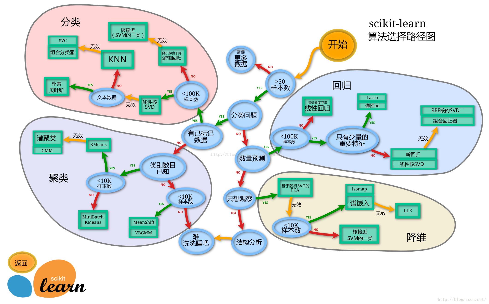

# 机器学习概述与算法体系（.xmind 树型结构）

```text
机器学习 (Machine Learning)
│
├── 一、基本概念与定义 (Basic Concepts & Definitions)
│   ├── 定义：让计算机从数据中自动学习规律，并对未知数据做出预测或决策
│   ├── 样本 (Sample / Instance)：一条数据记录
│   ├── 特征 (Feature)：描述样本的属性；特征向量 (Feature Vector)
│   ├── 标签 (Label / Target)：监督任务中的真实输出
│   ├── 特征空间 (Feature Space) 与 假设空间 (Hypothesis Space)
│   ├── 模型 (Model)：从输入到输出的映射函数
│   │   ├── 参数 (Parameter)：训练中学习得到，如权重、偏置
│   │   └── 超参数 (Hyperparameter)：训练前设定，如学习率、树的深度
│   ├── 损失函数 (Loss Function)：衡量预测与真实的误差
│   ├── 目标函数 (Objective Function) = 损失 + 正则化项 (Regularization)
│   ├── 经验风险 (Empirical Risk) 与 结构风险 (Structural Risk)
│   ├── 训练集 / 验证集 / 测试集 (Train / Validation / Test Set)
│   ├── 泛化能力 (Generalization)：对未见样本的表现
│   ├── 过拟合 (Overfitting)：训练集好、测试集差
│   ├── 欠拟合 (Underfitting)：训练集本身都学不好
│   ├── 偏差-方差权衡 (Bias-Variance Tradeoff)
│   ├── 交叉验证 (Cross-Validation)：K 折、留一法
│   └── 评估指标 (Evaluation Metrics)
│       ├── 分类：准确率 (Accuracy)、精确率 (Precision)、召回率 (Recall)、F1、AUC
│       └── 回归：MSE、RMSE、MAE、R²
│
├── 二、主要学习范式 (Main Learning Paradigms)
│   │
│   ├── 1. 监督学习 (Supervised Learning)
│   │   ├── 定义：使用带标签数据 (x, y)，学习映射 f: X → Y
│   │   ├── 任务类型：分类 (Classification)--标签不连续 / 回归 (Regression)--标签连续
│   │   ├── 线性回归 (Linear Regression)
│   │   │   └── 核心思想：最小二乘拟合线性关系；可解释性强，适合连续值预测
│   │   ├── 逻辑回归 (Logistic Regression)
│   │   │   └── 核心思想：Sigmoid 映射到概率；线性分类的强基线
│   │   ├── 决策树 (Decision Tree)
│   │   │   └── 核心思想：按信息增益 / 基尼指数递归划分；可解释、能处理非线性
│   │   ├── 支持向量机 (Support Vector Machine, SVM)
│   │   │   └── 核心思想：最大化分类间隔，核技巧 (Kernel Trick) 处理非线性
│   │   ├── 朴素贝叶斯 (Naive Bayes)
│   │   │   └── 核心思想：特征条件独立假设 + 贝叶斯定理；文本分类高效
│   │   ├── K 近邻 (K-Nearest Neighbors, KNN)
│   │   │   └── 核心思想：距离度量 + 邻居投票；懒惰学习，无需显式训练
│   │   ├── 集成学习 (Ensemble Learning)
│   │   │   ├── 随机森林 (Random Forest)：Bagging + 随机特征，降低方差
│   │   │   └── 梯度提升树 (GBDT / XGBoost / LightGBM)：Boosting 串行纠错，精度高
│   │   └── 神经网络 (Neural Network) 与 深度学习 (Deep Learning)
│   │       └── 核心思想：多层非线性变换 + 反向传播 (Backpropagation) 自动学特征；适合图像、语音、文本
│   │
│   ├── 2. 无监督学习 (Unsupervised Learning)
│   │   ├── 定义：只有无标签数据，挖掘内在结构、分布或模式
│   │   ├── 聚类 (Clustering)
│   │   │   ├── K-Means
│   │   │   │   └── 核心思想：迭代更新质心，最小化簇内距离；需预设 K，偏向球形簇
│   │   │   ├── DBSCAN
│   │   │   │   └── 核心思想：基于密度连通；可发现任意形状簇并识别噪声
│   │   │   ├── 层次聚类 (Hierarchical Clustering)
│   │   │   │   └── 核心思想：自底向上合并或自顶向下分裂，输出树状图
│   │   │   └── 高斯混合模型 (Gaussian Mixture Model, GMM)
│   │   │       └── 核心思想：多个高斯分布加权组合，EM 算法做软聚类
│   │   ├── 降维 (Dimensionality Reduction)
│   │   │   ├── 主成分分析 (Principal Component Analysis, PCA)
│   │   │   │   └── 核心思想：寻找最大方差的正交投影方向，去相关、降噪
│   │   │   ├── t-SNE / UMAP
│   │   │   │   └── 核心思想：保持局部邻域结构的非线性降维，主要用于可视化
│   │   │   └── 线性判别分析 (Linear Discriminant Analysis, LDA)
│   │   │       └── 注意：属有监督降维，最大化类间/类内散度比
│   │   ├── 关联规则 (Association Rules)
│   │   │   └── Apriori / FP-Growth：挖掘频繁项集与“啤酒-尿布”式规则
│   │   ├── 异常检测 (Anomaly Detection)
│   │   │   └── 孤立森林 (Isolation Forest)、One-Class SVM：识别偏离正常分布的样本
│   │   └── 自编码器 (Autoencoder)
│   │       └── 核心思想：编码-解码重构，学习压缩表示，可用于降维与去噪
│   │
│   ├── 3. 强化学习 (Reinforcement Learning)
│   │   ├── 定义：智能体 (Agent) 与环境 (Environment) 交互，通过奖励信号最大化累积回报
│   │   ├── 核心要素
│   │   │   ├── 状态 (State, S) / 动作 (Action, A) / 奖励 (Reward, R)
│   │   │   ├── 策略 (Policy, π)：状态到动作的映射
│   │   │   ├── 价值函数 (Value Function, V/Q) 与 折扣因子 (Discount Factor, γ)
│   │   │   └── 马尔可夫决策过程 (Markov Decision Process, MDP)：形式化建模框架
│   │   ├── 探索与利用 (Exploration vs. Exploitation)：ε-greedy、UCB
│   │   ├── Q-Learning
│   │   │   └── 核心思想：时序差分 (TD) 学习动作价值，off-policy，无需环境模型
│   │   ├── SARSA
│   │   │   └── 核心思想：on-policy 的 TD 控制，按实际执行策略更新
│   │   ├── 深度 Q 网络 (Deep Q-Network, DQN)
│   │   │   └── 核心思想：Q-Learning + 深度网络 + 经验回放；处理高维状态（如 Atari）
│   │   ├── 策略梯度 (Policy Gradient) / REINFORCE
│   │   │   └── 核心思想：直接对策略参数做梯度上升，适合连续/随机策略
│   │   ├── Actor-Critic（A2C / A3C）
│   │   │   └── 核心思想：Actor 选动作、Critic 评估价值，降低策略梯度方差
│   │   ├── 近端策略优化 (Proximal Policy Optimization, PPO)
│   │   │   └── 核心思想：裁剪策略更新幅度，稳定高效；RLHF 常用
│   │   ├── DDPG / SAC
│   │   │   └── 核心思想：面向连续动作空间的确定性/最大熵方法
│   │   └── AlphaGo / AlphaZero
│   │       └── 核心思想：蒙特卡洛树搜索 (MCTS) + 深度网络 + 自我对弈
│   │
│   └── 4. 其他重要范式 (Other Paradigms)
│       ├── 半监督学习 (Semi-Supervised Learning)：少量标签 + 大量无标签，如伪标签
│       ├── 自监督学习 (Self-Supervised Learning)：构造代理任务预训练，如 BERT、MAE、对比学习
│       ├── 迁移学习 (Transfer Learning) / 微调 (Fine-tuning)：复用源域知识
│       ├── 联邦学习 (Federated Learning)：数据不出本地，联合建模
│       └── 在线学习 (Online Learning)：数据流式到达，增量更新
│
├── 三、典型工作流程 (Typical Workflow)
│   ├── 1. 问题定义 (Problem Definition)：明确任务类型、目标与成功指标
│   ├── 2. 数据采集 (Data Collection)：来源、规模、标注方案
│   ├── 3. 数据预处理 (Data Preprocessing)
│   │   ├── 缺失值处理 (Imputation)、异常值处理 (Outlier Handling)
│   │   ├── 类别编码 (One-Hot / Label Encoding)
│   │   └── 标准化 / 归一化 (Standardization / Normalization)
│   ├── 4. 特征工程 (Feature Engineering)：利用专业的背景知识和技巧处理数据，让机器学习算法效果最好。
│   │        - 特征提取 -- 从原始数据中选择与任务相关的特征，以便于模型训练。（过滤式、包裹式、嵌入式）
│   │        - 特征预处理 -- 特征对模型产生影响；因量纲问题，有些特征对模型影响大、有些影响小。（标准化、归一化）
│   │        - 特征降维 -- 将原始数据的维度降到一个合理的维度，以便于模型训练。（PCA、LDA、t-SNE、UMAP）
│   │        - 特征选择 -- 提取的数据过多，需要选择出对模型训练有用的特征。（过滤式、包裹式、嵌入式）
│   │        - 特征组合 -- 将多个特征组合成一个新的特征，以便于模型训练。（组合式、嵌入式）
│   ├── 5. 数据集划分 (Dataset Splitting)：训练 / 验证 / 测试
│   ├── 6. 模型选择 (Model Selection)：依据任务、数据量、可解释性、成本
│   ├── 7. 模型训练 (Training) 与 超参数调优 (Hyperparameter Tuning)
│   │   └── 网格搜索 (Grid Search) / 随机搜索 (Random Search) / 贝叶斯优化 (Bayesian Optimization)
│   ├── 8. 模型评估 (Evaluation)：交叉验证、混淆矩阵、指标对比、误差分析
│   ├── 9. 部署上线 (Deployment)：批处理 / 在线推理、模型压缩与加速
│   ├── 10. 监控与迭代 (Monitoring & Iteration)：数据漂移 (Data Drift)、性能衰减、再训练
│   └── 附：建模流程执行细节 (Modeling Pipeline in Detail)
│       ├── 阶段 0：任务定义与评价设计
│       │   ├── 业务问题 → 机器学习任务：分类 / 回归 / 排序 / 生成
│       │   ├── 明确预测对象、预测时点、可用特征边界
│       │   └── 同时定义技术指标与业务指标，确定基线目标
│       ├── 阶段 1：数据理解与探索性分析 (Exploratory Data Analysis, EDA)
│       │   ├── 分布、缺失率、异常值、类别不平衡程度
│       │   ├── 特征与标签的相关性、时间结构与分组结构
│       │   └── 排查数据泄漏 (Data Leakage)：未来信息、标签穿越
│       ├── 阶段 2：数据准备与切分
│       │   ├── 清洗、去重、对齐、样本筛选 
│       │   ├── 按时间 / 用户 / 分组切分，避免随机切分造成乐观偏差
│       │   └── 数据版本管理 (Data Versioning)，保证可追溯
│       ├── 阶段 3：特征工程与预处理管线
│       │   ├── 特征构造、编码、缩放、缺失值填补
│       │   ├── 用管线 (Pipeline) 封装：仅用训练集 fit，再 transform 验证/测试集
│       │   └── 特征选择与重要性初筛
│       ├── 阶段 4：建立基线模型 (Baseline)
│       │   ├── 简单规则、均值/多数类预测、逻辑回归
│       │   └── 先有可比较基准，再逐步增加复杂度
│       ├── 阶段 5：模型训练与验证
│       │   ├── K 折交叉验证；时序任务用滚动/前向验证 (Walk-Forward Validation)
│       │   ├── 学习曲线 (Learning Curve) 判断欠拟合与过拟合
│       │   └── 多模型对比，关注均值与方差而非单次结果
│       ├── 阶段 6：误差分析与迭代
│       │   ├── 混淆矩阵、残差分析、分群/分时段切片评估
│       │   ├── 难例挖掘 (Hard Example Mining)
│       │   └── 针对性补数据、加特征、改损失函数或重采样
│       ├── 阶段 7：超参数调优与模型选择
│       │   ├── 网格搜索 / 随机搜索 / 贝叶斯优化
│       │   ├── 早停 (Early Stopping)、学习率调度 (Learning Rate Scheduling)
│       │   └── 调参只用验证集；测试集仅在最终评估时使用
│       ├── 阶段 8：模型解释与业务校验
│       │   ├── 特征重要性、SHAP / LIME、部分依赖图 (Partial Dependence Plot, PDP)
│       │   ├── 公平性、稳定性、边界与对抗场景检查
│       │   └── 业务评审，确定分类阈值 (Threshold) 与决策规则
│       ├── 阶段 9：部署、监控与再训练
│       │   ├── 模型序列化、在线/批量推理、特征一致性校验
│       │   ├── 灰度发布 (Canary Release)、A/B 测试、回滚策略
│       │   └── 监控数据漂移 (Data Drift) 与概念漂移 (Concept Drift)，触发再训练
│       └── 工程规范与参考框架
│           ├── 实验跟踪 (Experiment Tracking)：记录参数、指标、数据与代码版本
│           ├── 可复现性 (Reproducibility)：随机种子、环境锁定、流水线编排
│           └── CRISP-DM 六阶段：业务理解 → 数据理解 → 数据准备 → 建模 → 评估 → 部署
│
├── 四、常见应用场景 (Common Applications)
│   ├── 计算机视觉 (Computer Vision, CV)
│   │   └── 图像分类、目标检测 (Object Detection)、语义分割、OCR、人脸识别
│   ├── 自然语言处理 (Natural Language Processing, NLP)
│   │   └── 文本分类、情感分析、机器翻译、信息抽取、问答、大语言模型 (LLM)
│   ├── 推荐系统 (Recommender System)
│   │   └── 协同过滤 (Collaborative Filtering)、CTR 预估、召回-排序架构
│   ├── 语音处理 (Speech Processing)
│   │   └── 语音识别 (ASR)、语音合成 (TTS)、声纹识别
│   ├── 金融风控 (Finance & Risk Control)
│   │   └── 信用评分、欺诈检测 (Fraud Detection)、量化交易
│   ├── 医疗健康 (Healthcare)
│   │   └── 医学影像分析、辅助诊断、药物发现 (Drug Discovery)
│   ├── 智能制造 (Smart Manufacturing)
│   │   └── 预测性维护 (Predictive Maintenance)、质检、排产优化
│   ├── 自动驾驶 (Autonomous Driving)
│   │   └── 环境感知、路径规划、运动控制
│   └── 生物信息 (Bioinformatics)
│       └── 基因序列分析、蛋白质结构预测 (AlphaFold)
│
└── 五、挑战与发展趋势 (Challenges & Trends)
    ├── 主要挑战 (Challenges)
    │   ├── 数据层面：标注成本高、数据稀缺、隐私安全、数据偏差 (Data Bias)
    │   ├── 模型层面：可解释性 (Interpretability)、鲁棒性 (Robustness)、对抗攻击 (Adversarial Attack)
    │   ├── 工程层面：算力与能耗成本、模型规模与推理延迟
    │   └── 伦理与治理：公平性 (Fairness)、责任归属、可复现性 (Reproducibility)
    └── 发展趋势 (Trends)
        ├── 大模型与基础模型 (Foundation Models / Large Language Models)
        ├── 生成式 AI (Generative AI)：Diffusion、GAN、Transformer
        ├── 多模态学习 (Multimodal Learning)：图文音视频统一建模
        ├── 自监督预训练 (Self-Supervised Pre-training) 与 提示学习 (Prompt Learning)
        ├── 参数高效微调 (Parameter-Efficient Fine-Tuning, PEFT)：LoRA、Adapter
        ├── AutoML 与 MLOps：自动化建模与全生命周期运维
        ├── 图神经网络 (Graph Neural Network, GNN)：关系型数据建模
        ├── 神经符号结合 (Neuro-Symbolic AI)：感知 + 推理
        ├── 边缘 AI (Edge AI) 与 联邦学习 (Federated Learning)：隐私与低延迟
        └── AI 治理与对齐 (AI Governance & Alignment)
```

## 备注

- `线性判别分析 (LDA)` 常与 PCA 并列讲降维，但它使用标签，属监督方法，已在树中标注以免混淆。


# Sklearn算法选择流程图

